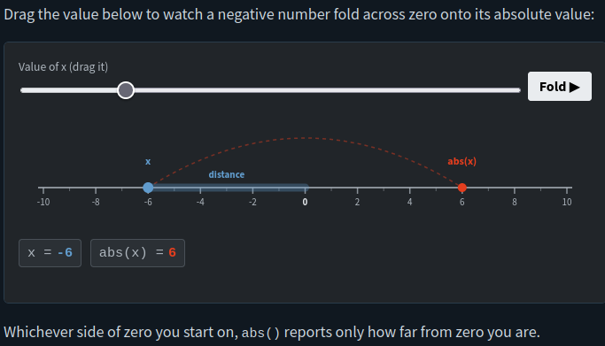
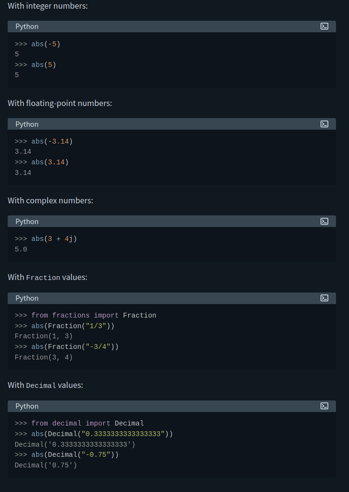

# abs()

abs(number, /)

    Return the absolute value of a number. The argument may be an integer, a floating-point number, or an object implementing __abs__(). If the argument is a complex number, its magnitude is returned.

The abs() function in Python returns a number’s absolute value, which is its distance from zero on the number line, regardless of its sign.

```py
>>> abs(-1)
1
>>> abs(1)
1
```



## abs() Signature
```py
abs(number, /)
```
## Arguments
| Argument |	Description                                    |
| ---------|---------------------------------------------------|
| number   | An integer, floating-point, or complex number for which to calculate the absolute value. Also accepts fractions, decimals and any object implementing .__abs__().

Return Value

   * For real numbers, returns a non-negative value of the same type as the argument, such as int, float, Fraction, or Decimal.
   * For complex numbers, it returns the magnitude as a float (that is, the square root of the sum of squares of real and imaginary parts).

## abs() Examples



## abs() Common Use Cases

The most common use cases for the abs() function include:
* Determining the distance between two points on a number line.
* Processing data in mathematical computations where only positive values are meaningful or allowed.
* Finding the magnitude of complex numbers.

## abs() Real-World Example

Suppose you’re tracking temperature changes in a city and want to find out how much the temperature fluctuates from the average, regardless of whether it’s a drop or an increase:
```py
temperatures = [22, 25, 18, 30, 15, 28, 21]

average_temp = sum(temperatures) / len(temperatures)

deviations = [abs(temp - average_temp) for temp in temperatures]

print("Absolute deviations:", *deviations, sep="\n")

# Output
Absolute deviations:
0.7142857142857153
2.2857142857142847
4.714285714285715
7.285714285714285
7.714285714285715
5.285714285714285
1.7142857142857153
```

